<p align="center">
  
</p>

<h1 align="center">NotBar</h1>

<p align="center">
  Un icono en la barra de menús que se vuelve rojo cuando alguna app del Dock tiene notificaciones.
</p>

---

NotBar es una app mínima de macOS que vive en la barra de menús. Vigila los iconos
del Dock y, cuando alguno muestra un badge (el globo rojo con el número de mensajes,
correos, etc.), pinta de **rojo** su icono de la barra. Así lo ves aunque
tengas el Dock oculto o la app en otro escritorio.

## Funciones

- Icono de la barra liso (blanco o negro según el modo) sin notificaciones y entero en
  rojo cuando hay alguna app con badge.
- Lista de las apps con notificaciones y su contador; haz clic en una para abrirla.
- **Icono de la barra** a elegir entre 25 símbolos rellenos y nítidos a cualquier
  resolución: formas (punto, cuadrado, estrella, corazón…), comunicación (campana,
  sobre, mensaje…) y otros (cuadrícula por defecto, bandera, rayo, huella…).
- **Color de notificación** a elegir: rojo (por defecto), naranja, amarillo, verde,
  menta, turquesa, azul, índigo, morado o rosa.
- **Abrir al iniciar sesión**.
- **Ocultar icono del Dock** (activado por defecto).
- Se adapta al modo claro y oscuro.

## Requisitos

- macOS 13 (Ventura) o posterior.
- Xcode o las Command Line Tools (`xcode-select --install`) para compilar.

## Instalación

```bash
cd ~/Projects/notbar
./build.sh install
```

Esto compila la app, la copia a `/Applications/NotBar.app` y la abre. Si solo quieres
compilar sin instalar, ejecuta `./build.sh` y tendrás la app en `build/NotBar.app`.

Conviene instalarla en `/Applications`: la opción "Abrir al iniciar sesión" funciona
mejor desde ahí.

## Permiso de Accesibilidad

macOS no tiene una API pública para leer los badges del Dock, así que NotBar los lee
con la API de Accesibilidad. Por eso necesita permiso la primera vez:

1. Abre NotBar. macOS mostrará un aviso; pulsa **Abrir Ajustes del Sistema**.
   También puedes usar **Conceder permiso de Accesibilidad…** desde el menú de NotBar.
2. En **Ajustes del Sistema → Privacidad y seguridad → Accesibilidad**, activa **NotBar**.
3. En un par de segundos el icono empezará a reflejar los badges.

NotBar solo lee el Dock. No lee el contenido de otras apps ni envía nada a ningún sitio.

## Uso

Haz clic en el icono de la barra para abrir el menú:

| Opción | Qué hace |
| --- | --- |
| Lista de apps | Muestra las apps con badge y su contador. Clic para abrirla. |
| Icono de la barra | Cambia el icono que se muestra en la barra de menús. |
| Color de notificación | Color con el que se pinta el icono cuando hay notificaciones. |
| Abrir al iniciar sesión | Arranca NotBar automáticamente al entrar en tu cuenta. |
| Ocultar icono del Dock | Quita o muestra NotBar en el Dock. |
| Salir de NotBar | Cierra la app (también con ⌘Q con el menú abierto). |

## Cómo funciona

Cada 2 segundos NotBar recorre los elementos de Accesibilidad del proceso del Dock
(`com.apple.dock`). De cada icono de app (`AXApplicationDockItem`) lee el atributo
`AXStatusLabel`, que contiene el texto del badge ("3", "•"…). Si alguno no está vacío,
pinta el icono de rojo. El código está en `Sources/NotBar/DockBadgeReader.swift`.

`AXStatusLabel` no es una API documentada por Apple, así que una versión futura de
macOS podría cambiarlo.

## Solución de problemas

**El icono no refleja los badges después de recompilar.**
Cada compilación se firma "ad hoc" y macOS puede dejar de reconocer el permiso aunque
NotBar siga apareciendo activado. En Ajustes → Accesibilidad, quita NotBar con el botón
"−" y vuelve a añadirla. Para evitarlo, firma con tu certificado:

```bash
SIGN_IDENTITY="Apple Development: Tu Nombre (XXXXXXXXXX)" ./build.sh install
```

**Finder o el Dock siguen mostrando el icono antiguo de la app.**
Es la caché de iconos de macOS. Ejecuta `killall Dock` o `touch /Applications/NotBar.app`.

**No veo el icono en la barra de menús.**
En los Mac con notch, si hay muchos iconos en la barra, algunos quedan ocultos detrás.
Cierra otras apps de la barra o usa una herramienta para gestionarlos.

**"Abrir al iniciar sesión" da error.**
Asegúrate de ejecutar NotBar desde `/Applications`. Si macOS pide aprobación, la verás
en **Ajustes del Sistema → General → Ítems de inicio**.

## Desarrollo

Para editar en Xcode: `open Package.swift`. Al ejecutar desde Xcode la app no corre
como bundle `.app`, así que "Abrir al iniciar sesión" no funciona ahí y el permiso de
Accesibilidad se pide para Xcode. Para probarla de verdad, usa `./build.sh install`.

```
Package.swift                 Paquete Swift (sin sandbox: la Accesibilidad no funciona con sandbox)
build.sh                      Compila, empaqueta y firma NotBar.app
Resources/
  Info.plist                  LSUIElement = true (arranca sin icono en el Dock)
  AppIcon.icns                Icono de la app
  AppIcon.png                 Icono de la app a 1024 px
Sources/NotBar/
  AppDelegate.swift           Arranque, menú y comprobación periódica
  DockBadgeReader.swift       Lectura de los badges del Dock por Accesibilidad
  StatusIcon.swift            Icono de la barra (SF Symbol) y color de notificación
  Settings.swift              Icono del Dock y abrir al iniciar sesión (SMAppService)
```

## Desinstalar

1. Desactiva **Abrir al iniciar sesión** desde el menú y sal de NotBar.
2. Borra `/Applications/NotBar.app`.
3. Quita NotBar de **Ajustes → Privacidad y seguridad → Accesibilidad**.
4. Opcional: borra sus preferencias con `defaults delete com.vtellez.notbar`.
